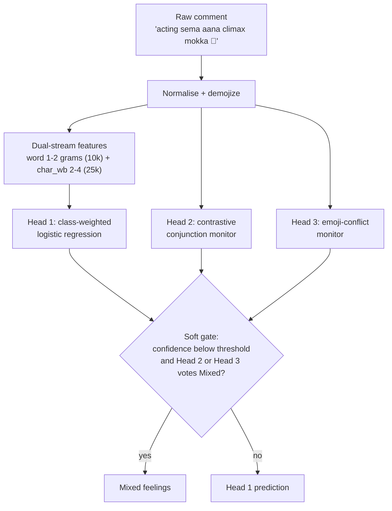

<div align="center">

# 🧠 ConG-MoE v2
### *Mitigating Majority-Class Bias in Code-Mixed Tanglish Sentiment Classification*

[](https://www.python.org/)
[](https://pytorch.org/)
[](#-results)
[](#-results)
[](LICENSE)
[](https://huggingface.co/spaces/pragadheesh06/ConG-MoE)
[](https://pragadheeshwar-d.github.io/ConG-MoE/)

<p align="center">
  <b>A fast three-head gated ensemble that reduces majority-class collapse in Romanized Tamil-English (Tanglish) YouTube comments, and runs on a regular CPU.</b>
</p>

[🤗 Hugging Face Demo](https://huggingface.co/spaces/pragadheesh06/ConG-MoE) •
[🌐 GitHub Pages](https://pragadheeshwar-d.github.io/ConG-MoE/) •
[Summary](#-summary) •
[Method](#-method) •
[Results](#-results) •
[Quick Start](#-quick-start) •
[Web App](#-interactive-web-application) •
[Structure](#-repository-structure) •
[Citation](#-citation)

---

</div>

## 📌 Summary

Tanglish is Romanized Tamil mixed with English. In a typical entertainment dataset, about **70% of comments are positive**, so standard classifiers fall back on *Positive* whenever a comment is ambiguous. On our 5,000-comment test set, an unweighted TF-IDF baseline scores **77.60% accuracy**, yet labels **75.0% of Mixed-feelings comments as Positive** (macro-F1 only 0.5256). We call this **majority-class collapse**.

This repository accompanies our paper. We compare **five architectures** on **20,000 comments** and propose **ConG-MoE v2**:

- Mixed-feelings recall: **20.55% → 74.49%**
- Unknown-state recall: **21.66% → 80.51%**
- Mixed→Positive collapse: **75.00% → 14.04%**
- Inference: **0.33 ms per comment** on one CPU core, over **6× faster** than CNN + BiLSTM
- Training: **15.5 s** on CPU, no GPU

> **Trade-off.** CNN + BiLSTM has the highest raw accuracy (86.12%) and macro-F1 (0.7578). ConG-MoE v2 gives up accuracy (77.48%) for much higher minority-class recall, lower collapse, and CPU-friendly latency, which suits content moderation, where missing a nuanced comment costs more than a few extra flags.

---

## 🔍 Why Tanglish Is Hard

| Bottleneck | What happens | How ConG-MoE v2 responds |
| :--- | :--- | :--- |
| **Spelling variation** | No standard spelling (`padam`, `padham`, `paadam`) makes word vocabularies large and sparse | Word-bounded character n-grams (`char_wb`, n = 2–4) |
| **Agglutinative suffixes** | `-la`, `-oda`, `-ku` attach to Tamil and English words; only **14.2%** of words matched a 242,337-entry Tamil transliteration dictionary (85.8% OOV) | Sub-word features instead of whole-word tokens |
| **Emoji stripping** | Cleaning removes emojis that carry sentiment (sarcasm becomes "positive") | Affect-preserving demojization |
| **Mid-sentence reversals** | “Sema hype *aana* padam fulla mokka”: positive words outweigh the negative clause in bag-of-words | Contrastive conjunction monitor (Head 2) |

---

## 🏛 Method

**Pre-processing**
- **Demojization:** emojis become text tokens (`emoji_fire`) instead of being removed
- **Run-length compression:** 3 or more repeated characters become 2 (`massssss` → `mass`)
- **Selective punctuation:** `?` is kept as a signal for Unknown-state comments

**Features:** word uni/bigrams (up to 10k, sub-linear TF-IDF) plus `char_wb` n-grams of length 2–4 (up to 25k), joined into a **35k-dimension sparse vector**.

**Class weights:** inverse frequency, `w_j = N / (K · n_j)` with N = 15,000 and K = 4:

| Positive | Negative | Mixed feelings | Unknown state |
| :---: | :---: | :---: | :---: |
| 0.36 | 1.89 | 2.14 | 4.50 |



- **Head 1, statistical base:** class posteriors P(c | x), base prediction and confidence conf(x) = max P(c | x)
- **Head 2, conjunction monitor:** votes *Mixed* when sentiment on either side of an adversative conjunction (*aana, aanal, irundhalum, aanaalum, but*) is opposite
- **Head 3, emoji-conflict monitor:** votes *Mixed* when positive words meet negative emojis, or the reverse
- **Soft gate:** the monitors act **only when Head 1 is unsure**. Per the paper, τ = 0.60.

### The five models compared

| # | Model | Description |
| :-: | :--- | :--- |
| 1 | TF-IDF + LR | Unigram TF-IDF (10k), emojis removed, unweighted logistic regression |
| 2 | BiLSTM | 20k vocabulary, 128-d embeddings, BiLSTM (64 per direction), unweighted loss |
| 3 | CNN + BiLSTM | Conv1D (128 filters, kernel 3) + BiLSTM (64), unweighted loss |
| 4 | ConG-Hybrid | Model 3 with demojized input and inverse-frequency class weights |
| 5 | **ConG-MoE v2** | Dual-stream features, class weights, three-head soft gate |

---

## 📊 Results

**Dataset:** 20,000 Tanglish YouTube comments (Positive 69.56%, Negative 13.22%, Mixed 11.67%, Unknown 5.55%), stratified 75/25 split: 15,000 train, 5,000 test. Experiments ran on a laptop with an 8-core CPU and 16 GB RAM, no GPU.

### 🎯 Held-out test set (N = 5,000)

| Model | Acc | Macro-F1 | Mixed Recall | Unknown Recall | Mixed→Positive Collapse | Latency (CPU) | Train |
| :--- | :---: | :---: | :---: | :---: | :---: | :---: | :---: |
| TF-IDF + LR *(baseline)* | 77.60% | 0.5256 | 20.55% | 21.66% | 75.00% ⚠️ | **0.007 ms** | 1.15 s |
| BiLSTM | 78.86% | 0.6168 | 40.24% | 40.07% | 43.84% | 0.555 ms | 140.88 s |
| CNN + BiLSTM *(Shanmugavadivel et al.)* | **86.12%** | **0.7578** | 64.55% | 72.20% | 28.42% | 1.987 ms | 204.18 s |
| ConG-Hybrid | 69.30% | 0.6476 | **82.19%** | 77.62% | **8.73%** | 1.870 ms | 370.52 s |
| 🏆 **ConG-MoE v2** *(proposed)* | 77.48% | 0.6887 | 74.49% | **80.51%** | 14.04% | 0.328 ms | **15.50 s** |

*Collapse is the share of true Mixed comments predicted as Positive (lower is better). Latency is per comment on one CPU thread.*

<p align="center">
  
</p>

- Macro-F1 improves by **31.0%** over the baseline (0.5256 → 0.6887).
- Mixed comments classified correctly: **120 → 435** of 584. Mixed→Positive errors: **438 → 82**.
- The baseline predicts Positive for 4,390 of 5,000 comments (87.8%), which explains its 77.6% accuracy.

### 🧪 Example predictions

| Comment (English gloss) | Truth | Baseline | ConG-MoE v2 |
| :--- | :---: | :---: | :---: |
| `padam sema mass verithanam aanal second half bore` *(great hype, but 2nd half boring)* | Mixed | Positive | **Mixed** |
| `acting sema aana screenplay worst direction waste` *(acting great, screenplay worst)* | Mixed | Positive | **Mixed** |
| `GOAT trailer Vera level... is that the new release, brother???` *(asks about OTT release)* | Unknown | Positive | **Unknown** |

> Evaluation on the full 20,000-comment corpus (which includes the training data) is also reported in the paper and saved in `docs/*_20k_results.csv`. Those numbers are higher and are not a held-out result.

---

## 🚀 Quick Start

### 1. Installation

```bash
git clone https://github.com/pragadheeshwar-d/ConG-MoE.git
cd ConG-MoE
pip install -r requirements.txt
pip install torch   # only needed to re-run the benchmark scripts
```

### 2. Interactive Terminal CLI

```bash
python run_cli.py
```

Or pass a comment directly:

```bash
python run_cli.py "acting sema aana climax mokka 🤮"
```

For each comment the CLI prints the processed text, the predicted state, the base model's prediction and confidence, whether the specialist heads overrode it to *Mixed feelings* (and why), the inference latency, and a per-class probability breakdown. Type `samples` for built-in examples, `exit` to quit.

### 3. Re-run the benchmarks

Run from the repository root (results are written to `docs/`):

```bash
python src/benchmark_5_models.py
python src/benchmark_p2_models.py
```

---

## 💻 Interactive Web Application

### 🌐 Live Demos
Experience the model live in your browser:
* 🤗 **Hugging Face Spaces**: [https://huggingface.co/spaces/pragadheesh06/ConG-MoE](https://huggingface.co/spaces/pragadheesh06/ConG-MoE)
* 🌐 **GitHub Pages**: [https://pragadheeshwar-d.github.io/ConG-MoE/](https://pragadheeshwar-d.github.io/ConG-MoE/)

### 🖥️ Run Locally
```bash
python run_web.py
```

Then open `http://localhost:5050` in your browser.

---

## 📁 Repository Structure

```text
├── data/
│   ├── tanglish_test_20000_with_labels.csv     # 20,000 labelled comments
│   └── tanglish_transliterated_lexicon.csv     # Tamil transliteration dictionary (242,337 words)
│
├── models/
│   └── tanglish_congmoe_model.pkl              # Pre-trained ConG-MoE v2
│
├── docs/
│   ├── index.html                              # Project page (GitHub Pages)
│   ├── ConG-MoE.pptx                           # Project presentation
│   ├── *_results.csv                           # Benchmark results (5k test and 20k full corpus)
│   └── *.png                                   # Benchmark charts
│
├── src/
│   ├── tanglish_sentiment_pipeline.py          # Pre-processing, features, ConG-MoE v2
│   ├── benchmark_5_models.py                   # Five-model comparison
│   ├── benchmark_p2_models.py                  # Baseline comparison
│   ├── predict_interactive.py                  # CLI prediction engine
│   └── web_app.py                              # Local web app
│
├── run_cli.py                                  # Launcher: CLI
├── run_web.py                                  # Launcher: web app
├── requirements.txt
├── SIH_Presentation_ConG_MoE.pptx
└── generate_sih_ppt.py
```

---

## ⚠️ Limitations

- The conjunction monitor depends on a **manually curated** list of Tamil adversative markers. Other code-mixed languages (Manglish, Tenglish) need their own lexicons.
- Raising minority recall lowers overall accuracy and adds some false alarms on Positive comments.
- Transformers (mBERT, XLM-R, IndicBERT, MuRIL) were not benchmarked; the paper argues from reported latency and GPU needs that they are impractical for CPU-only moderation queues.

**Future work:** learn the pivot lexicon automatically and extend to multilingual Dravidian code-mixed benchmarks.

---

## 👥 Authors & Acknowledgments

* **Pragadheeshwar D** — *Department of Information Technology, Karpagam College of Engineering*
* **Sriram G S** — *Department of Information Technology, Karpagam College of Engineering*
* **Cibi K** — *Department of Information Technology, Karpagam College of Engineering*
* **Sathiyarajan K** — *Department of Information Technology, Karpagam College of Engineering*

* **Dr. Kannimuthu S** — *Mentor, Department of Information Technology, Karpagam College of Engineering*

The dataset builds on public Tanglish comment corpora (Chakravarthi et al., 2020; Bhatia, Kaggle, 2021). Please follow the original sources' licenses.

---

## 📜 Citation

If you use ConG-MoE or our benchmark findings, please cite:

```bibtex
@misc{pragadheeshwar2026congmoe,
  title        = {Mitigating Majority-Class Bias in Code-Mixed Tanglish Sentiment Classification:
                  A Comparative Study of Sub-Word, Deep Sequential, and Discourse-Guided Architectures},
  author       = {Pragadheeshwar, D. and Sriram, G. S. and Cibi, K. and Sathiyarajan, K.},
  year         = {2026},
  howpublished = {GitHub repository},
  note         = {Department of Information Technology, Karpagam College of Engineering, Coimbatore, India},
  url          = {https://github.com/pragadheeshwar-d/ConG-MoE}
}
```

---

<div align="center">
  <sub>Built for code-mixed Dravidian natural language processing</sub>
</div>
