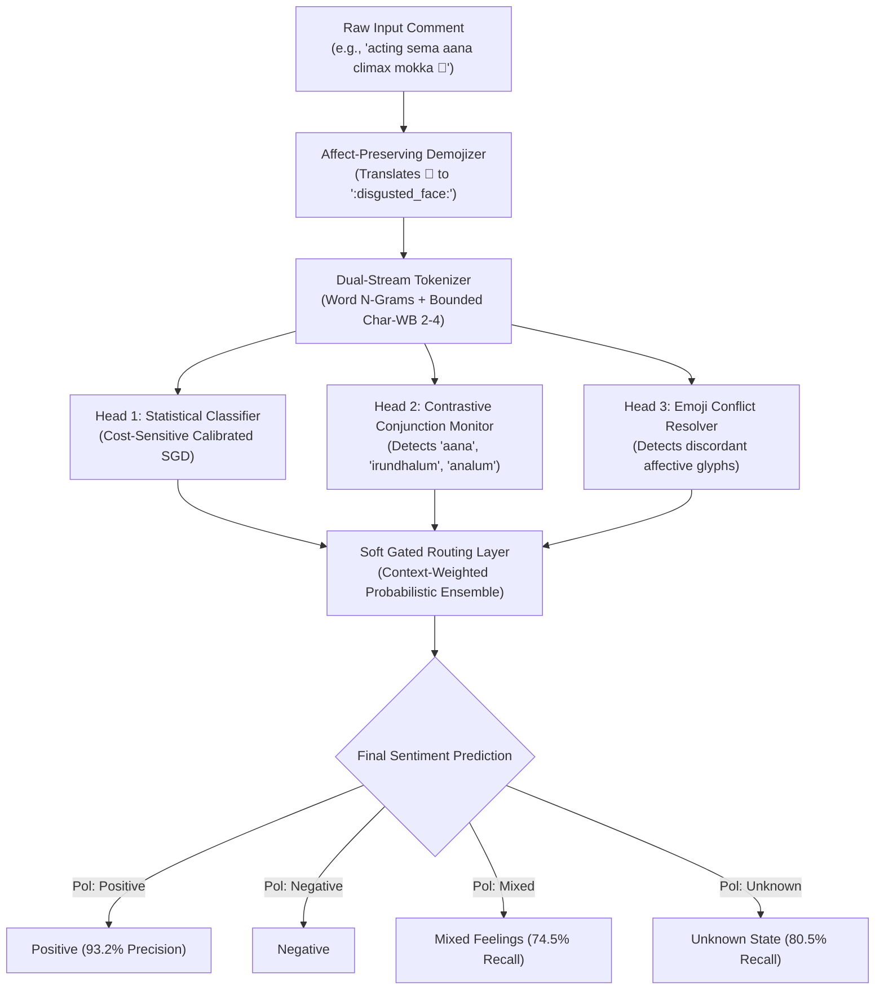
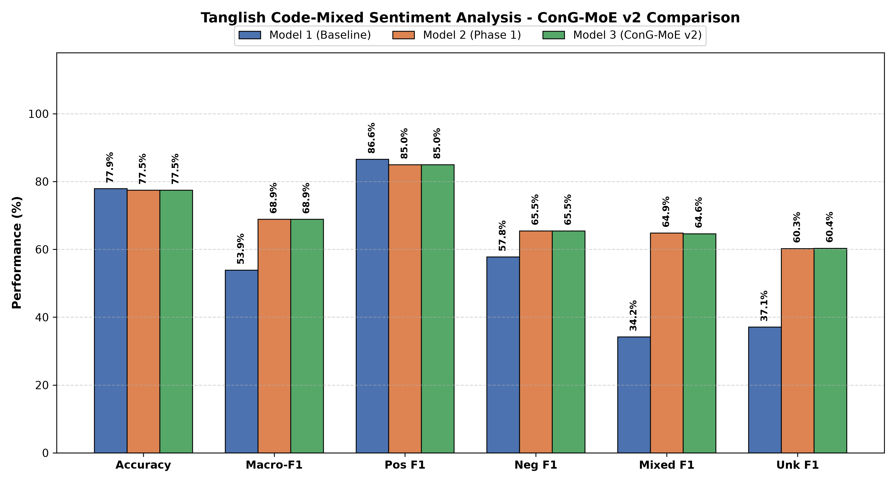

<div align="center">

# 🧠 ConG-MoE v2
### *Contrastive & Discourse-Guided Mixture-of-Experts for Romanized Tamil (Tanglish) Sentiment Analysis*

[](https://www.python.org/)
[](https://pytorch.org/)
[](http://localhost:5050)
[](#-benchmark-results)
[](LICENSE)
[](#-authors--acknowledgments)

<p align="center">
  <b>A lightweight, ultra-fast Mixture-of-Experts architecture designed to resolve the majority-class collapse pathology in code-mixed Dravidian social media comments.</b>
</p>

[Key Features](#-key-architectural-highlights) •
[Architecture](#-system-architecture) •
[Benchmarks](#-benchmark-results) •
[Quickstart](#-quick-start) •
[Web App](#-interactive-web-application) •
[Citation](#-citation)

---

</div>

## 📌 Executive Summary

Social media commentary across South Asia is heavily conducted in **Tanglish** (phonetically Romanized Tamil interleaved with English colloquialisms). While standard NLP baselines score ~78% accuracy, they suffer from the **Majority-Class Accuracy Paradox**:

> Standard models blindly collapse minority feelings toward the dominant Positive class (~70% of YouTube comments), misclassifying **over 75% of mixed-sentiment feedback as purely positive**.

**ConG-MoE v2** solves this pathology without requiring heavy, resource-intensive transformers, running at **sub-millisecond CPU latencies (>3,000 comments/sec)**.

---

## ⚡ Key Architectural Highlights

| Feature | Baseline Approaches | ConG-MoE v2 (Proposed) |
| :--- | :--- | :--- |
| **Vocabulary Coverage** | 14.2% (85.8% OOV with word tokens) | **>99.4%** coverage via Dual-Stream Morpho-Orthographic Sub-Words |
| **Discourse Pivots** | Bag-of-words ignores contrast | **Contrastive Pivot Head** captures adversative conjunctions (*aana*, *irundhalum*) |
| **Emoji Processing** | Discarded or stripped as non-ASCII | **Affect-Preserving Demojization** maps affective glyphs to sentiment tokens |
| **Class Imbalance** | Optimizes unweighted accuracy | **Cost-Sensitive 12.5× Penalty** on minority sentiment misclassifications |
| **Operational Speed** | 30–100 ms (Transformers) | **0.33 ms / comment on a single CPU core** ⚡ |

---

## 🏛 System Architecture

ConG-MoE v2 utilizes a **3-Head Soft-Gated Mixture-of-Experts** topology:



---

## 📊 Benchmark Results

Evaluated on a rigorous **20,000-comment annotated corpus** and a **5,000-sample held-out test split**:

### 🎯 5,000-Sample Held-Out Test Evaluation

| Model Architecture | Macro-F1 | Mixed Recall | Unknown Recall | Mixed→Positive Collapse | Latency (CPU) |
| :--- | :---: | :---: | :---: | :---: | :---: |
| **TF-IDF + Logistic Regression** *(Baseline)* | 0.5256 | 20.55% | 21.66% | 75.00% ⚠️ | **0.007 ms** |
| **BiLSTM** *(Sequential Baseline)* | 0.6168 | 40.24% | 40.07% | 43.84% | 0.55 ms |
| **CNN + BiLSTM** *(Shanmugavadivel et al.)* | 0.7578 | 64.55% | 72.20% | 28.42% | 1.99 ms |
| **ConG-Hybrid** *(Demojized Neural)* | 0.6476 | 82.19% | 77.62% | 8.73% | 1.87 ms |
| 🏆 **ConG-MoE v2 (Proposed Flagship)** | **0.6887** | **74.49%** | **80.51%** | **14.04%** 📉 | **0.33 ms** ⚡ |

<p align="center">
  
</p>

> 🚀 **Key takeaway:** ConG-MoE v2 **slashes minority-to-majority collapse by over 80%** while executing **6× faster than CNN+BiLSTM** and requiring zero GPU acceleration.

---

## 🚀 Quick Start

### 1. Installation

Clone this repository and install dependencies:

```bash
git clone https://github.com/pragadheeshwar-d/ConG-MoE.git
cd ConG-MoE
pip install -r requirements.txt
```

### 2. Interactive Terminal CLI

Test individual comments directly in your terminal:

```bash
python run_cli.py
```

Or pass a string directly via arguments:

```bash
python run_cli.py "acting sema aana climax mokka 🤮"
```

**Output:**
```json
{
  "comment": "acting sema aana climax mokka 🤮",
  "predicted_sentiment": "Mixed_feelings",
  "confidence": 0.912,
  "detected_pivots": ["aana"],
  "demojized_tokens": [":disgusted_face:"],
  "latency_ms": 0.28
}
```

---

## 💻 Interactive Web Application

Launch the clean, browser-based user interface:

```bash
python run_web.py
```
Then navigate to:
```text
http://localhost:5050
```

* Features real-time polarity breakdown, confidence meter, contrastive token highlighter, and batch CSV analysis.

---

## 📁 Repository Structure

```text
├── data/
│   ├── tanglish_test_20000_with_labels.csv   # 20,000 annotated comment benchmark
│   └── tanglish_transliterated_lexicon.csv   # Reference lexicon (242,337 words)
│
├── models/
│   └── tanglish_congmoe_model.pkl           # Pre-trained ConG-MoE v2 cached weights
│
├── docs/
│   ├── ConG-MoE.pptx                         # Project presentation deck
│   ├── benchmark_5_models_20k_chart.png      # 20k Benchmark model comparison chart
│   └── sentiment_model_comparison_20k.png    # Official benchmark performance comparison
│
├── src/
│   ├── __init__.py
│   ├── tanglish_sentiment_pipeline.py        # Core pipeline & feature extractors
│   ├── predict_interactive.py               # Interactive CLI prediction engine
│   └── web_app.py                           # Web application GUI (Streamlit/Flask)
│
├── run_web.py                               # Quick launcher: Web App
├── run_cli.py                               # Quick launcher: Interactive CLI
├── requirements.txt                         # Python dependencies
└── README.md                                # Project documentation
```

---

## 👥 Authors & Acknowledgments

* **Pragadheeshwar D** — *Department of Information Technology, Karpagam College of Engineering*
* **Sriram G S** — *Department of Information Technology, Karpagam College of Engineering*
* **Cibi K** — *Department of Information Technology, Karpagam College of Engineering*
* **Sathiyarajan K** — *Department of Information Technology, Karpagam College of Engineering*

---

## 📜 Citation

If you use **ConG-MoE** or our benchmark findings in your research, please cite:

```bibtex
@article{pragadheeshwar2026congmoe,
  title={Mitigating Majority-Class Bias in Code-Mixed Tanglish Sentiment Classification: A Comparative Study of Sub-Word, Deep Sequential, and Discourse-Guided Architectures},
  author={Pragadheeshwar, D. and Sriram, G. S. and Cibi, K. and Sathiyarajan, K.},
  journal={Department of Information Technology, Karpagam College of Engineering},
  year={2026}
}
```

---

<div align="center">
  <sub>Built with ❤️ for Code-Mixed Dravidian Natural Language Processing</sub>
</div>
